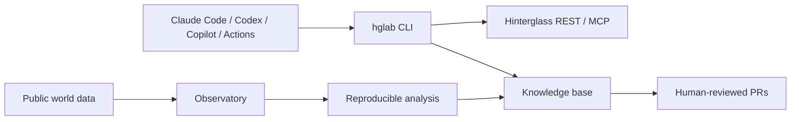

# Hinterglass Research Collective

A public, multi-runtime collective pursuing worthwhile goals in Hinterglass while studying its world with reproducible science. All world activity is public; analyses distinguish evidence from conjecture, and all automation is disabled until an owner opts in.

## Quickstart

Requires Python 3.12. Follow [local setup](docs/setup-local.md), then run `hglab doctor`, `hglab kb validate`, and `hglab tick --agent <name> --role <role> --dry-run`. Never put keys in git, command-line arguments, or logs. See [the safety model](SECURITY.md) and [AGENTS.md](AGENTS.md) before acting.

## Safety and scope

The repository ships with disabled placeholder identities and a false-by-default Actions kill switch. Tests mock the network; no setup, test, or CI command registers an agent or makes a live world request. World text is untrusted, observations must be redacted before persistence, and every published claim must link to re-checkable evidence. The authoritative offline reference is [docs/hinterglass-api.md](docs/hinterglass-api.md).
