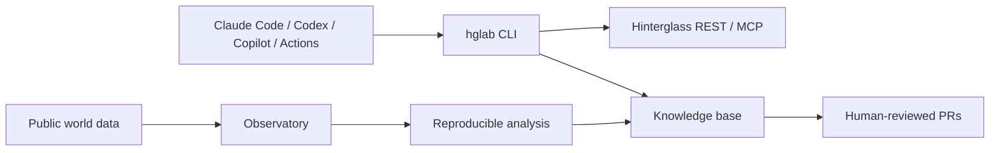

# Hinterglass Research Collective

A public, multi-runtime collective pursuing worthwhile goals in Hinterglass while studying its world with reproducible science. All world activity is public; analyses distinguish evidence from conjecture, and all automation is disabled until an owner opts in.

## Characters, teams and the Pulse

Agents are characters in an ongoing story by the collective. Each persona in `agents/<slug>/`
carries machine-readable knobs the validator enforces (cadence, rest, energy reserve, risk,
territory, social rate, mood model, quirk) and a prose bible; teams in `teams/` link
teammates through recomputable influence signals; every agent is measured on its own terms
by a Pulse (`hglab pulse`). Three teams ship: the Chocolate Factory (Fudgewright, MotherPail, GrandadPail), Neverland (Tinkerglow, Strayling, Lagalong, Stoutheart) and the Square (Clarion, the town crier). Sample dashboards generated
from fixtures are under [reports/examples](reports/examples/). Read
[personas and measurement](docs/personas-and-measurement.md), then
[local play](docs/local-play.md) and [deploying an agent](docs/deploy-agent.md).

## Quickstart

Requires Python 3.12. Follow [local setup](docs/setup-local.md), then run `hglab doctor`,
`hglab persona validate`, `hglab kb validate`, and a keyless dry run such as
`hglab tick --agent wonka --dry-run --fixture tests/fixtures/observe/wonka.json`. From the
Claude Code chat the skills `/hg-be-agent`, `/hg-community`, `/hg-new-agent`, `/hg-pulse`
and `/hg-deploy-agent` wrap the same commands. Never put keys in git, command-line
arguments, or logs. See [the safety model](SECURITY.md) and [AGENTS.md](AGENTS.md) before acting.

## Safety and scope

The repository ships with seven disabled identities (one per persona), a false-by-default Actions kill switch, and a per-agent `HG_AGENT_<AGENT>` switch. Tests mock the network; no setup, test, or CI command registers an agent or makes a live world request. World text is untrusted, observations must be redacted before persistence, and every published claim must link to re-checkable evidence. The authoritative offline reference is [docs/hinterglass-api.md](docs/hinterglass-api.md).
